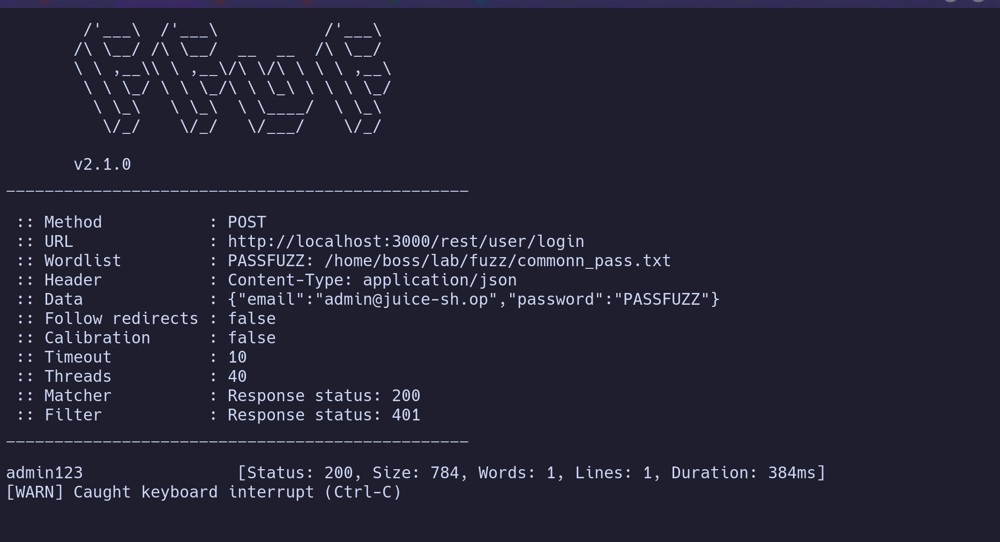

# Broken Authentication — Missing Rate Limiting on Login Endpoint Enables Credential Brute-Force

**Severity:** High (CVSS 3.1: 8.2 — AV:N/AC:L/PR:N/UI:N/S:U/C:N/I:H/A:L)
**Category:** A07:2021 — Identification and Authentication Failures / CWE-307: Improper Restriction of Excessive Authentication Attempts

## Summary
The login endpoint does not enforce any rate limiting, account lockout, or delay after repeated failed authentication attempts. Given a known, valid email address, an attacker can brute-force the account's password without restriction.

## Affected Component
- Endpoint: `POST http://localhost:3000/rest/user/login`
- Parameter(s): `email`, `password`

## Steps to Reproduce
1. Identify a valid, registered email address (e.g. via the username enumeration vector documented separately, or any other means).
2. Send repeated `POST` requests to the login endpoint with the target email fixed and the password field substituted with each entry from a password wordlist.
3. Observe that no account lockout, CAPTCHA, or response delay is triggered regardless of the number of failed attempts.
4. Continue until a request returns HTTP 200 with a valid authentication token, confirming the correct password.

## Proof of Concept

```
Method  : POST
URL     : http://localhost:3000/rest/user/login
Header  : Content-Type: application/json
Data    : {"email":"admin@juice-sh.op","password":"PASSFUZZ"}
Matcher : Response status: 200
Filter  : Response status: 401
```

A match was returned after a short period, with no throttling, lockout, or delay observed at any point during the scan:

```
admin123    [Status: 200, Size: 784, Words: 1, Lines: 1, Duration: 384ms]
```

The scan was manually terminated via keyboard interrupt once the valid credential was identified; no rate limiting had been triggered up to that point.



## Impact
An attacker can systematically guess passwords for any known account without restriction, as demonstrated by the successful compromise of the `admin@juice-sh.op` account using a common password (`admin123`) from a standard wordlist. This grants full administrative control over user data, orders, and application configuration. The same technique applies to any other account whose email address is known or has been enumerated.

## Suggested Fix
Implement rate limiting on the login endpoint (e.g. progressive delays or temporary account lockout after a threshold of failed attempts for a given account or source IP), and consider CAPTCHA after repeated failures. Enforce a minimum password strength policy to reduce the impact of brute-force attempts that do get through, particularly for privileged accounts.

## References
- CWE-307
- A07:2021
