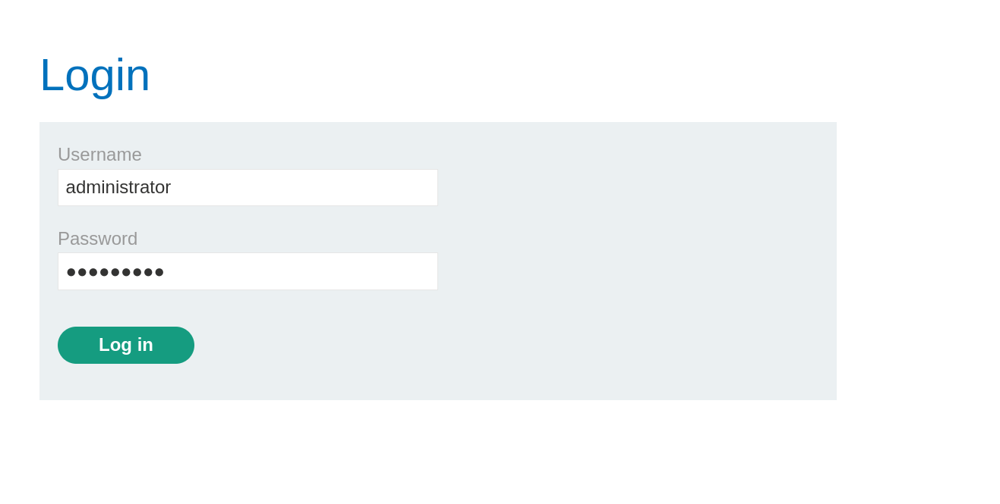
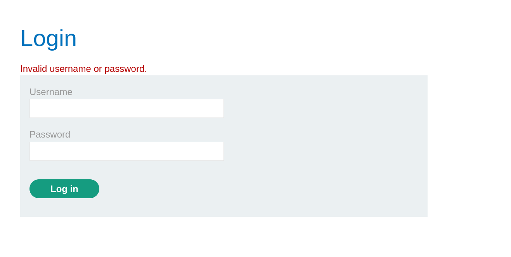
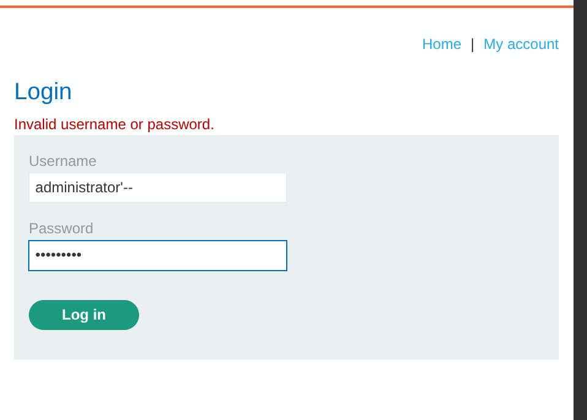

# Lab: SQL Injection Vulnerability Allowing Login Bypass

> **Platform:** PortSwigger Web Security Academy  
> **Module:** SQL Injection  
> **Lab:** SQL injection vulnerability allowing login bypass  
> **Lab Link:** https://portswigger.net/web-security/learning-paths/sql-injection/sql-injection-subverting-application-logic/sql-injection/lab-login-bypass  
> **Goal:** Perform a SQL injection attack that logs in to the application as the `administrator` user.

---

## 1. Lab Goal

The goal of this lab was to perform a SQL injection attack on the login form to subvert the application's authentication logic and log in as the `administrator` user without knowing their password.

---

## 2. Given Information

The lab gave the following information:

- The application contains a SQL injection vulnerability in the login function.
- `administrator` is a valid username.

---

## 3. Vulnerability Summary

The application's login form takes the user-supplied `username` input and concatenates it directly into a backend `SELECT` SQL query without proper sanitization or parameterization. By supplying `administrator'--` in the username field, an attacker can close the username string literal early and comment out the rest of the SQL query—specifically the `AND password = '...'` condition—bypassing the password check entirely.

---

## 4. Observation

I navigated to the login endpoint where I was presented with the standard login form. To test how the form behaves under normal conditions, I entered `administrator` as the username along with a random password.



Submitting the form returned an invalid login screen because the password did not match.



---

## 5. Initial Testing & Exploiting the Vulnerability

To bypass the password check, I returned to the login form and entered `administrator'--` into the username field, alongside a random password.



This input generated the following SQL query in the backend:

```sql
SELECT * FROM users WHERE username = 'administrator'--' AND password = '{password}'
```

Because the `--` sequence comments out everything that follows it in SQL, the `AND password = '{password}'` check was completely ignored by the database. The query simply selected the `administrator` user directly, logging me into the account and solving the lab.

---

## 6. Correct Testing Approach

1. Locate authentication forms where user credentials are checked against a backend database.
2. Verify normal behavior using a known username (`administrator`) and a random password.
3. Inject a single quote (`'`) followed by a SQL comment sequence (`--`) after the username to terminate the string literal and comment out the subsequent password verification logic.

---

## 7. Exploitation Steps

1. Navigated to the login endpoint of the application.
2. Entered `administrator` and a random password into the login form, which returned an invalid credentials screen.
3. Entered `administrator'--` into the username field and a random string into the password field.
4. Submitted the form, which commented out the password check in the backend SQL query and logged me in as `administrator`, solving the lab.

---

## 8. Evidence

### Normal Login Attempt
```text
Username: administrator
Password: [random_password]
Result: Invalid username or password.
```

### Exploit Payload
```text
Username: administrator'--
Password: [random_password]
```

### Injected Backend SQL Query
```sql
SELECT * FROM users WHERE username = 'administrator'--' AND password = '{password}'
```

---

## 9. Why This Worked

This worked because the backend application built the authentication SQL query using direct string concatenation rather than prepared statements.
- The single quote (`'`) closed the `username` string literal right after `administrator`.
- The double-dash (`--`) instructed the database parser to treat the remainder of the query (`' AND password = '{password}'`) as a comment.
- Effectively, the executed query became `SELECT * FROM users WHERE username = 'administrator'`, which returned the administrator's record and logged me in immediately.

---

## 10. Remediation / Fix

To prevent SQL injection login bypasses, the application should:
- **Use Parameterized Queries (Prepared Statements):** Ensure that both the `username` and `password` inputs are bound as strict parameters so that characters like `'` and `--` are treated as literal text rather than executable SQL syntax.
- **Separate Authentication Logic:** Alternatively, fetch the user record by username using a parameterized query first, and then verify the password hash in the application code.

---

## 11. Lessons Learned

- Login forms that concatenate user input into a `WHERE username = '...' AND password = '...'` query are vulnerable to logic subversion via SQL comments.
- Injecting `'--` into the username field is a classic and fast way to test if the password check can be commented out altogether.

---

## 12. Final Summary

In this lab, I exploited a SQL injection vulnerability in the application's login form. After seeing that logging in with `administrator` and a random password failed, I supplied `administrator'--` in the username field. This altered the backend SQL query to comment out the password verification step, allowing me to log in directly as the administrator and solve the lab.
